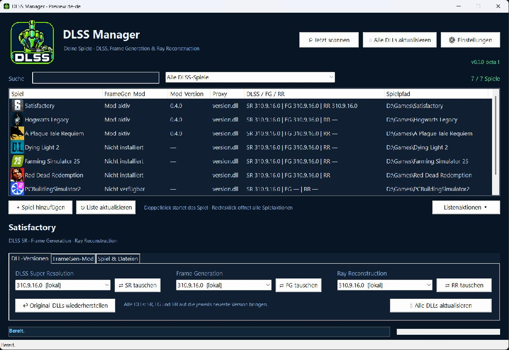
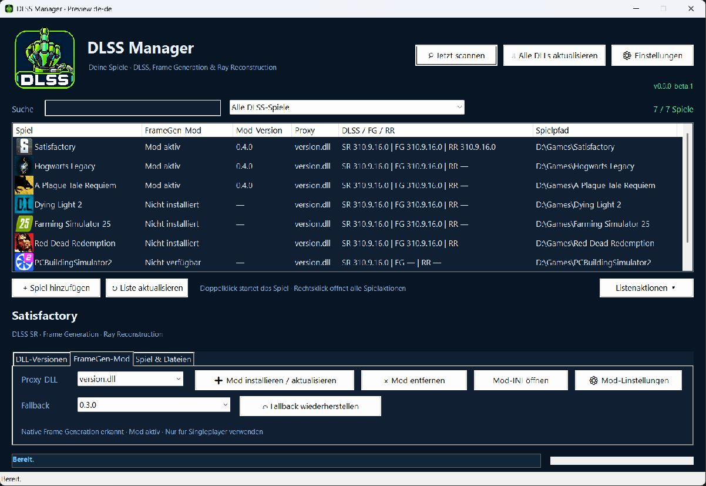
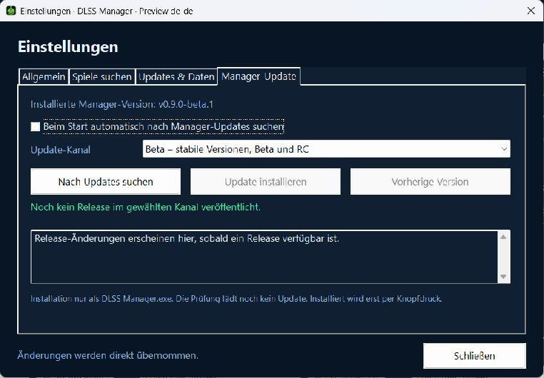

**Sprache / Language:** **Deutsch** · [English](README.md)

<sub>Weitere Sprachen — noch nicht verfügbar: Español · Français · Português (Brasil) · Italiano · Polski · Русский · 简体中文 · 日本語</sub>

<p align="center">
  
</p>

# DLSS Manager

**Entwicklungsstand: 0.9.0-beta.1** · Windows 10/11 x64 · Deutsch & Englisch

[Vorschau](#vorschau) · [Funktionen](#funktionen) · [Starten](#starten) · [Manager-Updates](#manager-updates-beta-und-stabile-versionen) · [Releases](https://github.com/MrSchwafel/DLSS-Manager/releases)

**DLSS-DLLs verwalten, Spiele finden und die SM86-FrameGen-Mod installieren — in einer Windows-Oberfläche.**

DLSS Manager ist ein mit AutoHotkey v2 entwickeltes Community-Tool. Es erkennt lokale DLSS-Dateien, zeigt ihre Versionen an und kann sie gegen andere verfügbare Versionen austauschen. Zusätzlich verwaltet es die FrameGen-Mod aus [dlssg_for_sm86](https://github.com/sdli1995/dlssg_for_sm86), einschließlich Updates und spielbezogener Fallbacks.

Das Logo nimmt künstliche Hardware-Grenzen aufs Korn. Der Manager ist ein unabhängiges Projekt und steht in keiner Verbindung zu NVIDIA.

> [!WARNING]
> **Nur für Singleplayer-Spiele verwenden.** DLL-Austausch und Proxy-Mods können Anti-Cheat-Systeme auslösen und zu Sperren führen. Ein gefundener DLSS-Eintrag bedeutet nicht, dass ein Spiel bedenkenlos verändert werden kann. Multiplayer- und Anti-Cheat-Spiele sollten ausgeschlossen werden; die Erkennung ist keine Garantie für eine vollständige Anti-Cheat-Prüfung.

## Vorschau

Die Aufnahmen zeigen die deutsche Oberfläche des Entwicklungsstands **0.9.0-beta.1** in einer separaten Vorschau. Spielpfade, Versionsnummern und Statusanzeigen sind Beispieldaten.

### Spielebibliothek und DLSS-Versionen



*DLSS SR, Frame Generation und Ray Reconstruction lassen sich direkt beim ausgewählten Spiel verwalten.*

<details>
<summary><strong>FrameGen-Mod und Fallback ansehen</strong></summary>



*Mod-Verwaltung und DLL-Austausch haben getrennte Aktionsbereiche.*

</details>

<details>
<summary><strong>Manager-Updates und Beta-Kanal ansehen</strong></summary>



*Update-Kanal wählen, Release-Änderungen lesen und verfügbare Manager-Updates nach Bestätigung installieren.*

</details>

## Sprache

Unter **Einstellungen → Allgemein → Sprache** lassen sich Deutsch, Englisch oder die automatische Systemspracherkennung auswählen. Standardmäßig wird die Windows-Sprache übernommen, sofern eine passende Sprachdatei vorhanden ist; andernfalls wird Englisch geladen. Die Auswahl bleibt gespeichert.

Die eigenständigen UTF-8-Sprachdateien liegen in [`resources/languages`](resources/languages). Hinweise zu eigenen Übersetzungen stehen in der [Sprachdatei-Dokumentation](resources/languages/README.md).

## Funktionen

### Spielebibliothek und Suche

- Spieleordner nach DLSS Super Resolution, Frame Generation und Ray Reconstruction durchsuchen.
- Exakte DLL-Pfade und installierte Dateiversionen erfassen.
- Einzelne Spiele manuell hinzufügen sowie Namen, EXE-Pfad und Icon anpassen.
- Scan-Ordner verwalten oder ausgewählte lokale Laufwerke vollständig durchsuchen.
- Unsichere EXE-Zuordnungen nach dem Scan prüfen.
- EXE-Dateinamen global blockieren und Spielordner samt Unterordnern ausschließen.
- Spiele über Suche und Filter eingrenzen; weitere Aktionen stehen per Rechtsklick bereit.

### DLSS-DLLs

| Typ | Datei |
| --- | --- |
| Super Resolution / SR | `nvngx_dlss.dll` |
| Frame Generation / FG | `nvngx_dlssg.dll` |
| Ray Reconstruction / RR | `nvngx_dlssd.dll` |

- Verfügbare Versionen aus dem öffentlichen DLSS-Swapper-Manifest laden.
- DLL-Versionen bei Bedarf herunterladen und lokal vorhalten.
- Einzelne DLL-Typen auf eine ausgewählte Version wechseln.
- Alle vorhandenen DLL-Typen eines Spiels gemeinsam auf die jeweils neueste Manifest-Version aktualisieren.
- DLLs aller berücksichtigten, geschlossenen Spiele aktualisieren.
- Original-DLLs vor dem ersten Austausch als `.bak` sichern und wiederherstellen.

Die drei DLL-Typen werden unabhängig verwaltet. Ihre neuesten Versionsnummern müssen nicht identisch sein. Manifest-Einträge ohne gültig gemeldete Signatur sowie als Entwicklungsversion markierte Dateien werden aussortiert; vorhandene Manifest-Prüfsummen werden für die Dateiprüfung verwendet.

### FrameGen-Mod

- SM86-Mod aus dem GitHub-Release-Cache installieren und aktualisieren.
- Installation nur bei erkannter nativer `nvngx_dlssg.dll` freigeben.
- Bereits installierte Mods automatisch auf einen neueren Release-Stand bringen.
- Vorhandene Mod-Versionen für einen spielbezogenen Fallback sichern.
- Nach einem Fallback automatische Mod-Updates für dieses Spiel pausieren.
- Mod-INI bearbeiten und spielbezogene Einstellungen verwalten.
- MFG-Empfehlungen anhand der unterstützten NVIDIA-Datenbankinformationen in die Mod-Konfiguration übernehmen.

**Das Austauschen einer DLSS-DLL und die Installation der FrameGen-Mod sind getrennte Funktionen.** Ein Spiel mit ausschließlich Super Resolution kann seine SR-DLL aktualisieren, erhält dadurch aber keine native FrameGen-Unterstützung.

## Voraussetzungen

- Windows 10/11, 64 Bit, mit Schreibzugriff auf den Manager-Ordner und die bearbeiteten Spielordner.
- Für das Quellskript: **AutoHotkey v2**. AutoHotkey v1 ist nicht kompatibel.
- Für den DLL-Hintergrunddownload: Windows PowerShell mit `Expand-Archive` sowie die mitgelieferte Datei `resources/PreloadLatestDlls.ps1`.
- Für das Entpacken bei einzelnen DLL-Downloads: `tar.exe` im Suchpfad, üblicherweise Bestandteil aktueller Windows-Installationen.
- Internetzugang für Manifest-, Datenbank-, Mod- und DLL-Downloads.
- Für die FrameGen-Mod eine vom jeweiligen Mod-Projekt unterstützte Kombination aus GPU, Treiber und Spiel.

Die neueste DLL ist nicht automatisch die beste Version für jedes Spiel. Kompatibilität und Verhalten hängen vom Spiel und der verwendeten Mod ab.

## Starten

### Lokales Quellskript

Die `.ahk`-Dateien einschließlich `Compiler.ahk` werden privat gehalten und sind nicht Bestandteil dieses Repositorys. Die folgenden Schritte gelten nur, wenn das lokale Quellskript bereits vorliegt.

1. Die Projektdateien in einen beschreibbaren Ordner entpacken.
2. AutoHotkey v2 installieren.
3. `DLSS Manager.ahk` starten.

Alternativ aus PowerShell im Projektordner:

```powershell
& "C:\Program Files\AutoHotkey\v2\AutoHotkey64.exe" ".\DLSS Manager.ahk"
```

Den Ordner `resources` mit seinen mitgelieferten Dateien beim Skript belassen. Einstellungen, Spieleliste, Logs, Cache und Backups liegen gesammelt unter `data`. Ältere Ordnerstrukturen werden beim Start übernommen.

### Kompilierte Version

`DLSS Manager.exe` ausführen und die zugehörigen Ressourcenordner im selben Verzeichnis belassen. Für eine kompilierte Version wird keine separate AutoHotkey-Installation zum Ausführen benötigt; PowerShell und die Hintergrunddownload-Datei werden weiterhin benötigt.

## Erste Einrichtung

1. **Einstellungen → Spiele suchen → Scan-Ordner verwalten** öffnen.
2. Gezielt die eigenen Spielebibliotheken hinzufügen, etwa die Bibliotheksordner von Steam, Epic oder Ubisoft. Nach dem Hinzufügen eines Scan-Ordners wird die Suche gestartet.
3. Gefundene Spiele prüfen und unsichere EXE-Zuordnungen nach dem Scan bearbeiten. Ungeeignete Spiele oder Ordner ausschließen.
4. Unter **Einstellungen → Updates & Daten** bei Bedarf die NVIDIA-Datenbank abgleichen und den FrameGen-Mod-Cache aktualisieren.
5. Ein Spiel in der Liste auswählen und die gewünschten Aktionen im Detailbereich ausführen.

Beim Programmstart wird das DLL-Manifest im Hintergrund geprüft und die jeweils neueste verfügbare Version von SR, FG und RR im lokalen Repository bereitgestellt. **Dieser Download in den Cache ist noch kein Austausch der Spiel-DLLs.**

## Bedienung

Ein Doppelklick auf ein Spiel startet dessen hinterlegte EXE. Das Rechtsklick-Menü bietet die wichtigsten Spielaktionen unabhängig vom gerade geöffneten Reiter.

### DLL-Versionen

- Über das Dropdown eine Version auswählen und mit **SR tauschen**, **FG tauschen** oder **RR tauschen** gezielt diesen DLL-Typ wechseln.
- **Alle DLLs aktualisieren** aktualisiert die vorhandenen DLL-Typen des ausgewählten Spiels auf die jeweils neueste Manifest-Version. Die einzelnen Dropdown-Auswahlen bestimmen diesen Sammel-Updatevorgang nicht.
- **Original-DLLs wiederherstellen** spielt die vorhandenen `.bak`-Dateien zurück.

Der Knopf **Alle DLLs aktualisieren** oben im Hauptfenster führt den Sammelvorgang für alle berücksichtigten Spiele aus. Laufende und ignorierte beziehungsweise ausgeschlossene Spiele werden dabei übersprungen.

### FrameGen-Mod

Hier stehen Proxy-Auswahl, Mod-Installation, Mod-Einstellungen, Deinstallation und Fallback bereit.

Für die Installation muss im Spiel eine native `nvngx_dlssg.dll` vorhanden sein. Ist nur `nvngx_dlss.dll` vorhanden, bleibt die Mod-Installation gesperrt.

Bei einem verfügbaren Fallback lässt sich eine vorherige Mod-Version auswählen und wiederherstellen. Danach sind automatische **Mod-Updates** für dieses Spiel pausiert. Eine erneute manuelle Installation beziehungsweise Aktualisierung hebt diese Pause auf. Diese Pause ist keine Sperre für separate DLSS-DLL-Updates.

### Spiel & Dateien

Hier lassen sich Spiel- und Log-Ordner öffnen, die EXE im Explorer anzeigen, Name, Pfad und Icon anpassen oder das Spiel beim Auto-Scan ignorieren. **Aus Liste entfernen** entfernt den Verwaltungseintrag und deinstalliert keine Spieldateien.

## Status und Filter

| Status | Bedeutung |
| --- | --- |
| Nicht installiert | Native FG-DLL erkannt, aber keine aktive SM86-Mod festgestellt. |
| Nicht verfügbar | Keine native FG-DLL erkannt; die FrameGen-Mod kann nicht installiert werden. Vorhandene SR-/RR-DLLs lassen sich weiterhin verwalten. |
| Aktiv (SM86) | Mod-Ordner und ausgewählte Proxy-DLL sind vorhanden. Der Status ist keine Funktionsprüfung im laufenden Spiel. |
| Update verfügbar | Der erkannte Mod-Stand unterscheidet sich vom lokalen Release-Cache. |
| Fallback-Version, Updates pausiert | Eine ältere Mod-Version ist aktiv und für automatische Mod-Updates gesperrt. |
| Pfad, DLL oder Ordner fehlt | Der Eintrag oder die Mod-Installation ist unvollständig und sollte geprüft werden. |

Bestehende Mod- und Fehlerzustände bleiben sichtbar, auch wenn eine native FG-Datei später fehlt.

Die Filter unterscheiden unter anderem alle DLSS-Spiele, Spiele mit FG, SR-Spiele ohne FG, bereits angepasste Spiele, aktive Mods, verfügbare Updates und Probleme. **Bereits gemoddet / angepasst** berücksichtigt auch vorhandene Original-DLL-Backups.

## Einstellungen und Automatik

| Option / Vorgang | Verhalten |
| --- | --- |
| Mit Windows starten | Legt beim Einschalten eine Autostart-Verknüpfung für den aktuellen Benutzer an. Der Manager startet minimiert im Tray. |
| Manager immer im Vordergrund halten | Schaltbare, gespeicherte Einstellung für Hauptfenster und Einstellungen; standardmäßig aus. |
| Automatische Spielsuche | Bei Aktivierung zum Start und anschließend alle fünf Minuten in den konfigurierten Scan-Ordnern suchen. |
| Automatische DLL-Updates | Optional jede Minute berücksichtigte, geschlossene Spiele anhand des verfügbaren Manifest-Standes prüfen und bei Bedarf aktualisieren. |
| Mod-Updateprüfung | Beim Start und anschließend alle 30 Minuten den GitHub-Release-Stand prüfen; bereits installierte, nicht pausierte Mods können aktualisiert werden. |

Bereits aktuelle DLL-Dateien werden beim Sammel-Update anhand ihrer Prüfsumme erkannt und nicht erneut ersetzt. Die Minutenprüfung ist keine erneute Online-Manifest-Abfrage pro Spiel; neue Versionslisten werden beim Start oder über die manuelle Manifest-Aktualisierung geladen.

Minimieren legt den Manager im Tray ab. Über das Tray-Menü lässt sich das Fenster wieder öffnen oder das Programm beenden. Das Schließen des Hauptfensters beendet den Manager.

## Manager-Updates: Beta und stabile Versionen

Unter **Einstellungen → Manager-Update** zeigt der Manager seine installierte Version und verfügbare Releases an. Die Prüfung beim Programmstart lässt sich abschalten; eine Installation erfordert weiterhin deine Bestätigung.

| Update-Kanal | Berücksichtigte Releases |
| --- | --- |
| Stabil | Nur stabile Versionen |
| Beta | Stabile Versionen sowie Beta- und RC-Versionen |

Bei neuen Beta-Installationen ist der Beta-Kanal vorausgewählt. Eine gespeicherte Auswahl bleibt erhalten. Der Updater berücksichtigt die Versionsreihenfolge und führt bei einem Kanalwechsel kein automatisches Downgrade durch.

Der erste geplante Tag lautet **`v0.9.0-beta.1`**. Download, SHA-256-Prüfung, Sicherung der betroffenen Programmdateien und Neustart sind vorbereitet. Bei einem Dateifehler während des Austauschs versucht der Helfer, die vorherigen Dateien zurückzuspielen. Über **Vorherige Version** lässt sich eine vorhandene Programm-Sicherung auch manuell wiederherstellen.

**Im AHK-Skriptbetrieb ist nur die Prüfung freigegeben.** Der Programmaustausch ist für die kompilierte `DLSS Manager.exe` vorgesehen. Persönliche Daten unter `data/`, Spiel-DLLs und private AHK-Dateien werden dabei nicht ersetzt.

Der vollständige Update- und Wiederherstellungsdurchlauf mit kompilierten Releases ist vor der Veröffentlichung noch zu prüfen.

## Backups und Wiederherstellung

### Originale DLSS-DLLs

Vor dem ersten Austausch wird neben der jeweiligen Spiel-DLL eine Sicherung angelegt, zum Beispiel:

```text
nvngx_dlss.dll
nvngx_dlss.dll.bak
```

Weitere Updates überschreiben dieses ursprüngliche Backup nicht. Nach erfolgreicher Wiederherstellung über **Original-DLLs wiederherstellen** werden die zurückgespielten `.bak`-Dateien entfernt.

### Mod-Fallbacks

Mod-Sicherungen liegen strukturiert unter `data/backups/mods`. Sie enthalten den gesicherten Mod-Ordner, seine INI und die zugehörige Proxy-DLL. Der Verlauf wird auf bis zu fünf Sicherungen pro Spiel begrenzt.

Mod-Fallbacks und Original-DLL-Backups erfüllen unterschiedliche Aufgaben. **Mod entfernen** setzt ausgetauschte SR-/FG-/RR-DLLs nicht auf ihre Originalversion zurück. Dafür die separate Original-Wiederherstellung verwenden.

## Ordnerstruktur

Diese Übersicht zeigt die lokale Installation. Auf GitHub liegen Dokumentation und öffentliche Ressourcen; die Startdatei und `data/` bleiben lokal. `data/` wird beim ersten Start angelegt.

```text
DLSS Manager/
├── DLSS Manager.ahk / DLSS Manager.exe
├── README.md
├── README.de.md
├── resources/                 Logos, Downloader und languages/
└── data/
    ├── manager_config.ini
    ├── games.json
    ├── logs/
    ├── cache/                 mod/ und dlls/
    └── backups/               Mod-Fallbacks und Wartungssicherungen
```

Beim Verteilen der EXE den Ordner `resources` mitliefern. `data` wird beim ersten Start angelegt. Für ein Update die eigene `data`-Struktur behalten; sie enthält die Spieleliste und persönlichen Einstellungen.

## Dateien und Ordner

| Pfad | Inhalt |
| --- | --- |
| `DLSS Manager.ahk` | AutoHotkey-v2-Quellskript. |
| `resources/logo.png` | GUI-Logo mit DLSS-Schriftzug. |
| `resources/app-icon.png` | Vereinfachte Icon-Vorlage ohne Schrift. |
| `resources/logo.ico`, `resources/favicon.ico` | Icons in mehreren Auflösungen. |
| `data/games.json` | Spieleliste, DLL-Pfade, Metadaten und spielbezogene Einstellungen. |
| `data/manager_config.ini` | Allgemeine Einstellungen, Scan-Ordner und Scan-Regeln. |
| `data/cache/mod/` | Heruntergeladener FrameGen-Mod und Datenbank-Cache. |
| `data/backups/mods/` | Spielbezogene Mod-Sicherungen. |
| `resources/PreloadLatestDlls.ps1` | Mitgelieferter Hintergrund-Downloader. |
| `data/cache/dlls/manifest.json` | Lokal gespeichertes DLL-Manifest. |
| `data/cache/dlls/dlss/`, `data/cache/dlls/dlssg/`, `data/cache/dlls/dlssd/` | Lokal vorgehaltene DLL-Versionen. |
| `data/logs/preload.log` | Protokoll der DLL-Bereitstellung. |
| `data/logs/dll_update.log` | Fehlerprotokoll der Sammel-DLL-Updates. |
| `data/logs/scan_debug.log` | Diagnoseprotokoll der Spielsuche. |

Spielepfade und lokale Einstellungen gehören zur eigenen Installation. Vor einem Upload auf GitHub persönliche `data/games.json`-, INI-, Log- und Backup-Dateien prüfen und aus dem Repository ausschließen. Heruntergeladene DLLs und Mod-Caches nicht ohne Prüfung ihrer jeweiligen Weitergabebedingungen veröffentlichen.

## Fehlerbehebung

**Ein Spiel wird nicht gefunden**

Den tatsächlichen Installationsordner als Scan-Ordner hinterlegen und erneut suchen. Anschließend unsichere Zuordnungen, ausgeschlossene Ordner und die EXE-Blockliste prüfen. Ein Spiel ohne eine der drei unterstützten DLL-Dateien wird durch diese DLL-Suche nicht automatisch erkannt. Bei Bedarf manuell hinzufügen und `data/logs/scan_debug.log` prüfen.

**„Nicht verfügbar“, obwohl DLSS im Spiel vorhanden ist**

Super Resolution und Frame Generation verwenden unterschiedliche Dateien. Für die SM86-Mod wird die native `nvngx_dlssg.dll` benötigt. Eine SR-DLL allein reicht nicht.

**Downloads oder Versionslisten fehlen**

Unter **Einstellungen → Updates & Daten** die Versionsliste aktualisieren. Prüfen, ob `resources/PreloadLatestDlls.ps1` mitgeliefert wurde, PowerShell verfügbar ist und der Manager-Ordner beschreibbar ist. Weitere Hinweise stehen in `data/logs/preload.log`.

**Ein Spiel funktioniert nach einer Änderung nicht mehr richtig**

Das Spiel schließen. Bei einem DLL-Tausch die Original-DLLs wiederherstellen oder eine andere verfügbare DLL-Version wählen. Bei einem Mod-Update einen vorhandenen Mod-Fallback verwenden. Mod und Original-DLLs bei Bedarf getrennt zurücksetzen.

**Für einen Fehlerbericht hilfreich**

Spielname, GPU, Treiberversion, betroffene DLL-/Mod-Version, ausgeführte Aktion und relevante Log-Auszüge angeben. Persönliche Pfade vor dem Veröffentlichen entfernen.

## Selbst kompilieren

Kompilieren ist optional. Bei einem vorbereiteten Release genügt `DLSS Manager.exe` zusammen mit dem mitgelieferten Ordner `resources/`. Zum Selbstkompilieren werden das privat gepflegte Quellskript `DLSS Manager.ahk`, AutoHotkey v2 x64 und Ahk2Exe benötigt. Die AHK-Quelldateien und Compiler-Helfer sind nicht Bestandteil dieses öffentlichen Repositorys.

| Möglichkeit | Verwendung | Ergebnis |
| --- | --- | --- |
| Ahk2Exe direkt | Quellskript auswählen und manuell kompilieren | EXE |
| Allgemeiner AHK v2 Compiler (optional, separat bereitgestellt) | Skript, Ausgabe, Laufzeit und Icon per Oberfläche wählen; auch für andere AHK-v2-Projekte nutzbar | EXE |
| Lokale `release/Compiler.ahk` | Manager kompilieren und Release-Dateien in einem Ablauf vorbereiten | EXE, ZIP, SHA-256-Prüfsumme und Release-Texte |

### Optional: allgemeiner AHK v2 Compiler

Wenn dir die eigenständige `AHK Compiler.ahk` vorliegt, kannst du sie als Oberfläche für Ahk2Exe verwenden:

1. Eine laufende kompilierte Manager-Instanz schließen und `AHK Compiler.ahk` mit AutoHotkey v2 starten.
2. `DLSS Manager.ahk` als Quellskript auswählen.
3. Als Ausgabe `DLSS Manager.exe` im Hauptordner des Managers festlegen.
4. Die installierte **AutoHotkey-v2-64-Bit-Laufzeit**, üblicherweise `AutoHotkey64.exe`, und optional `resources/logo.ico` als Icon wählen.
5. **EXE erstellen** anklicken. Den vollständigen Ordner `resources/` neben der erzeugten EXE beibehalten.

Der allgemeine Compiler benötigt ein installiertes Ahk2Exe. Er erzeugt die EXE; externe Ressourcen werden nicht automatisch eingebettet. Release-ZIPs, Prüfsummen und GitHub-Releases erstellt er nicht. Diese neue eigenständige Variante wurde noch nicht mit einem Build-Durchlauf getestet.

Für den vollständigen lokalen Release-Ablauf des Managers dient `release/Compiler.ahk`. Nach manuellem Kompilieren kann alternativ die lokale `release/Prepare-Release.ps1` das Veröffentlichungspaket separat erstellen. Beide Helfer veröffentlichen keinen Release automatisch. Änderungen am Quellskript oder eingebetteten Icon erfordern erneutes Kompilieren.

## Datenquellen und Credits

- [AutoHotkey](https://www.autohotkey.com/) — Skriptsprache und Windows-Oberfläche.
- [sdli1995/dlssg_for_sm86](https://github.com/sdli1995/dlssg_for_sm86) — verwaltete FrameGen-Mod.
- [beeradmoore/dlss-swapper](https://github.com/beeradmoore/dlss-swapper) und [DLSS-Swapper Manifest Builder](https://github.com/beeradmoore/dlss-swapper-manifest-builder) — DLL-Versionsinformationen und Downloadreferenzen. Der Manager benötigt keine laufende DLSS-Swapper-Installation.
- [JZ6/DLSSdb](https://github.com/JZ6/DLSSdb) — verwendete RTX-/DLSS-Datenbankinformationen.

Der Manager ist keine offizielle NVIDIA-Anwendung. Fremde DLLs, Mods und Datenquellen unterliegen den Bedingungen ihrer jeweiligen Rechteinhaber und Projekte.
