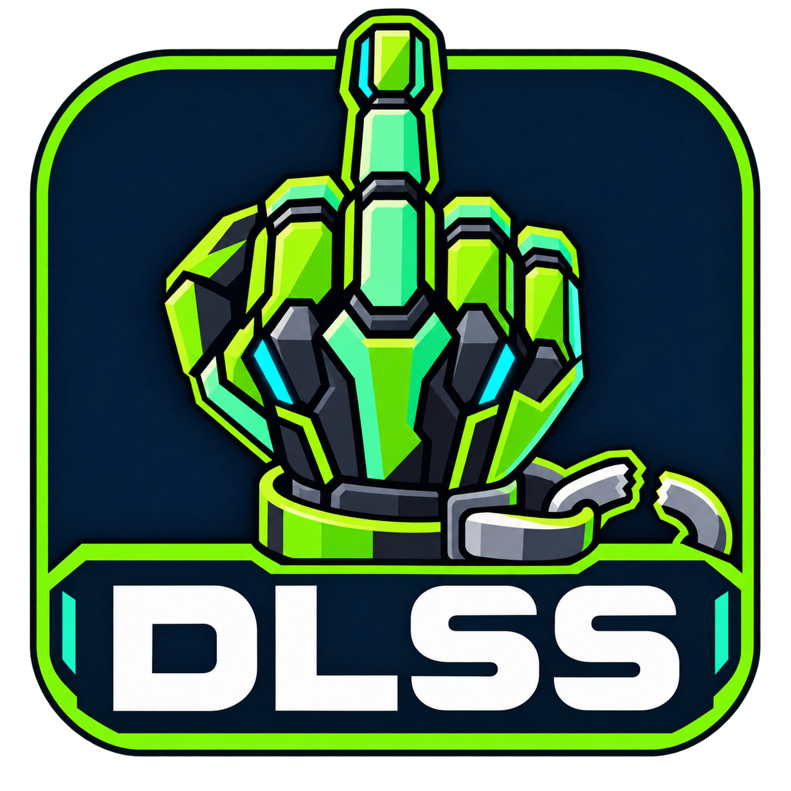
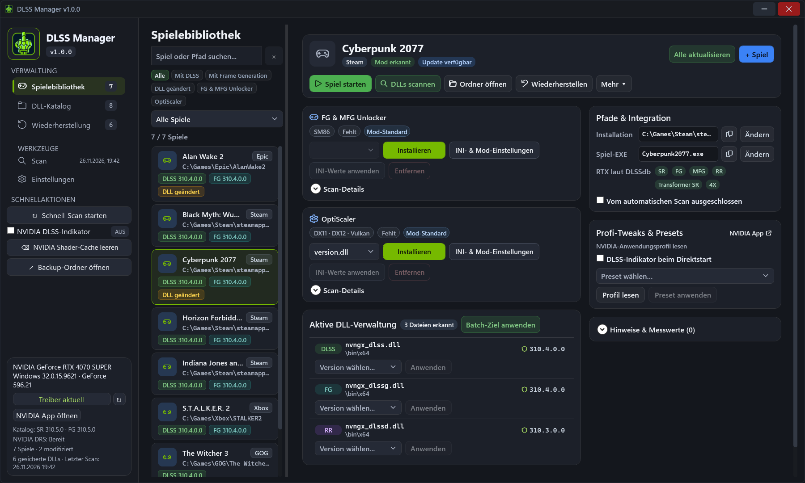
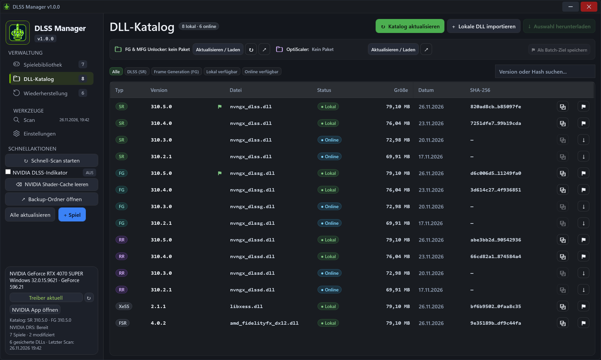
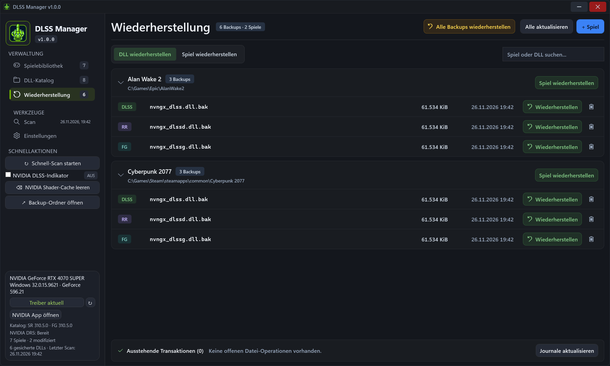

<p align="center">
  
</p>

<h1 align="center">DLSS Manager</h1>

<p align="center"><strong>Verwalte Upscaling, Frame Generation und NVIDIA-Treiber in einer Windows-App.</strong></p>

<p align="center">
  Windows x64 · C# / WPF · Deutsche und englische Oberfläche<br>
  <a href="README.md">English</a> · <strong>Deutsch</strong>
</p>

<p align="center">
  <strong><a href="https://github.com/MrSchwafel/DLSS-Manager/releases">Releases ansehen</a></strong> ·
  <a href="#installation">Installation</a> ·
  <a href="#erste-schritte">Erste Schritte</a> ·
  <a href="docs/guides/usage.de.md">Anleitung</a>
</p>

<p align="center">
  <a href="docs/screenshots/library.png"></a>
  <br>
  <sub>Spielebibliothek und Ansicht für ein einzelnes Spiel in DLSS Manager 1.0.0. Die Screenshots zeigen Beispieldaten.</sub>
</p>

## Was du damit machen kannst

| Funktion | Beschreibung |
| --- | --- |
| **Spiele finden** | Durchsuche Steam, Epic Games, Ubisoft Connect, GOG und Xbox / Game Pass. Ergänze bei Bedarf eigene Scanordner oder Spiele. |
| **Upscaling-DLLs verwalten** | Prüfe und tausche DLLs für DLSS Super Resolution, Frame Generation, Ray Reconstruction, XeSS und FSR. Lade oder importiere Versionen und prüfe geplante Batch-Änderungen vor dem Anwenden. |
| **Mods pro Spiel einrichten** | Installiere den FrameGen & MFG Unlocker (SM86) oder OptiScaler, wähle einen Proxy und konfiguriere globale Vorlagen und einzelne INI-Profile. |
| **Originaldateien zurückholen** | Stelle Original-DLLs einzeln oder pro Spiel wieder her. Unter **Wiederherstellung** kannst du auch unterbrochene Dateivorgänge zurückrollen. |
| **NVIDIA-Treiber verwalten** | Prüfe WHQL- und Hotfix-Releases, vergleiche die Release Notes und wähle bei Bedarf eine ältere Version für einen Downgrade. |

## Ein Blick in die App

| DLL-Katalog | Wiederherstellung |
| :---: | :---: |
| [](docs/screenshots/dll-catalog.png) | [](docs/screenshots/recovery.png) |
| Versionen durchsuchen, Pakete laden und lokale x64-DLLs importieren. | Original-DLL-Sicherungen prüfen und einzeln oder pro Spiel wiederherstellen. |

## Installation

1. Öffne [GitHub Releases](https://github.com/MrSchwafel/DLSS-Manager/releases) und lade das Windows-x64-ZIP herunter, sobald es verfügbar ist. Du kannst die App auch [aus dem Quellcode bauen](#aus-dem-quellcode-bauen).
2. Entpacke das komplette ZIP in einen beschreibbaren Ordner und starte **DLSSManager.App.exe**. Die .NET Desktop Runtime ist im ZIP enthalten.
3. Standardmäßig nutzt die App `Dokumente\DLSS Manager`. Wähle unter **Einstellungen** einen anderen Ordner oder starte mit `DLSSManager.App.exe --portable`, um den Ordner `data` neben der EXE zu verwenden.

Auf einem deutschsprachigen Windows startet die App auf Deutsch, auf anderen Systemen auf Englisch. Unter **Einstellungen → Allgemein → Sprache** kannst du die Sprache wechseln.

> [!WARNING]
> **DLL-Tausch und Proxy-Mods nur für Einzelspieler-Spiele verwenden.** Sie können Anti-Cheat-Systeme auslösen. Die Erkennung kann Spiele übersehen.

## Erste Schritte

1. Öffne **Scan**, um installierte Spiele zu finden, oder füge in der **Spielebibliothek** einen Eintrag hinzu.
2. Wähle ein Spiel und klicke auf **DLLs scannen**. Bestätige die Spiel-EXE, falls mehrere Kandidaten zur Auswahl stehen.
3. Suche im **DLL-Katalog** eine Ersatzversion und prüfe den Zielpfad in der Spielansicht, bevor du sie anwendest. Mit **Alle aktualisieren** öffnest du einen Batch-Plan zur Prüfung.

Die [Anleitung](docs/guides/usage.de.md) erklärt Paketprüfung, DLL- und Mod-Einstellungen, Wiederherstellung, Treibervorschau und Fehlerbehebung.

## Aus dem Quellcode bauen

Öffne auf Windows x64 PowerShell 7 im Stammordner des Repositorys. Installiere ein mit [global.json](global.json) kompatibles .NET SDK.

```powershell
.\build.ps1
.\src\DLSSManager.App\bin\Release\net10.0-windows\DLSSManager.App.exe
```

Verwende beim Packen eine Version, für die in `artifacts` noch kein ZIP liegt.

```powershell
.\publish.ps1
.\verify-release.ps1 -Package .\artifacts\DLSS-Manager-CSharp-win-x64-1.0.0.zip
```

Der [Repository-Aufbau](docs/guides/usage.de.md#repository-aufbau) zeigt, wo Oberfläche, Kernlogik und Dokumentation liegen.

## Datenquellen und Credits

- Der FrameGen & MFG Unlocker (SM86) stammt von [sdli1995/dlssg_for_sm86](https://github.com/sdli1995/dlssg_for_sm86).
- Der DLL-Katalog bezieht Versionsinformationen und Download-URLs vom [DLSS Swapper Manifest Builder](https://github.com/beeradmoore/dlss-swapper-manifest-builder).
- RTX-Funktionsangaben und Spieldaten liefert [JZ6/DLSSdb](https://github.com/JZ6/DLSSdb).
- Die unterstützten Mods für Upscaling und Frame Generation umfassen [OptiScaler](https://github.com/optiscaler/OptiScaler).

DLSS Manager ist ein unabhängiges Community-Projekt. Das Logo nimmt künstliche Hardware-Grenzen aufs Korn. Für DLLs, Mods und Daten Dritter gelten deren jeweilige Lizenzen und Nutzungsbedingungen.
