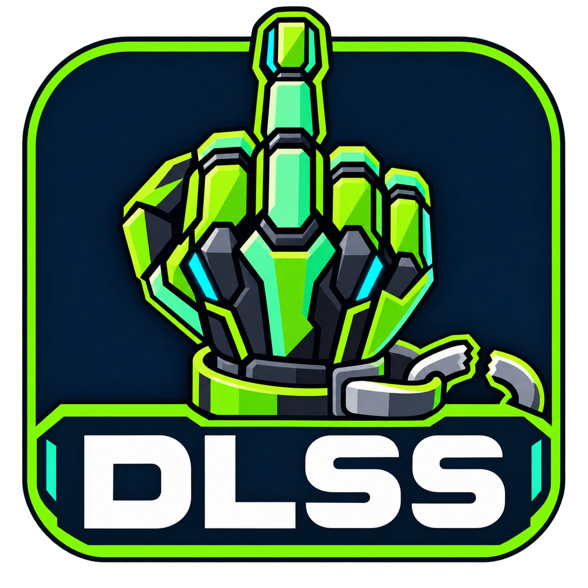
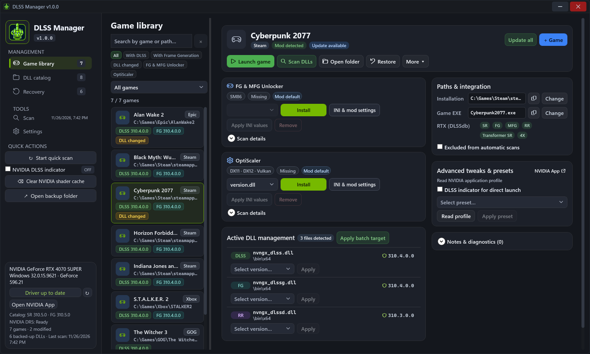
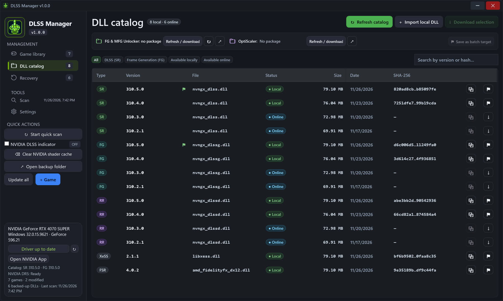
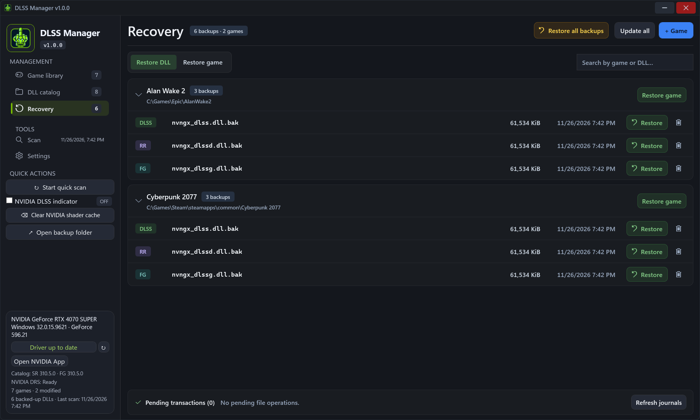

<p align="center">
  
</p>

<h1 align="center">DLSS Manager</h1>

<p align="center"><strong>Manage upscaling, Frame Generation and NVIDIA drivers from one Windows app.</strong></p>

<p align="center">
  Windows x64 · C# / WPF · English and German interface<br>
  <strong>English</strong> · <a href="README.de.md">Deutsch</a>
</p>

<p align="center">
  <strong><a href="https://github.com/MrSchwafel/DLSS-Manager/releases">View releases</a></strong> ·
  <a href="#installation">Installation</a> ·
  <a href="#quick-start">Quick start</a> ·
  <a href="docs/guides/usage.md">User guide</a>
</p>

<p align="center">
  <a href="docs/screenshots/library-en.png"></a>
  <br>
  <sub>Game library and per-game controls in DLSS Manager 1.0.0. Screenshots use sample data.</sub>
</p>

## What you can do

| Feature | What it does |
| --- | --- |
| **Find your games** | Scan Steam, Epic Games, Ubisoft Connect, GOG and Xbox / Game Pass. Add games and scan folders manually when needed. |
| **Manage upscaling DLLs** | Inspect and swap DLSS Super Resolution, Frame Generation, Ray Reconstruction, XeSS and FSR. Download or import versions and review batch changes before applying them. |
| **Set up mods per game** | Install the FrameGen & MFG Unlocker (SM86) or OptiScaler, choose a proxy and configure global templates and individual INI profiles. |
| **Recover original files** | Restore original DLL backups individually or by game, and roll back interrupted file operations from **Recovery**. |
| **Manage NVIDIA drivers** | Review WHQL and Hotfix releases, compare driver notes and select a previous version for a downgrade. |

## A closer look

| DLL catalog | Recovery |
| :---: | :---: |
| [](docs/screenshots/dll-catalog-en.png) | [](docs/screenshots/recovery-en.png) |
| Browse versions, download packages and import local x64 DLLs. | Inspect original DLL backups and restore them individually or by game. |

## Installation

1. Open [GitHub Releases](https://github.com/MrSchwafel/DLSS-Manager/releases) and download the Windows x64 ZIP when available. You can also [build from source](#build-from-source).
2. Extract the entire ZIP to a writable folder and start **DLSSManager.App.exe**. The ZIP includes the .NET Desktop Runtime.
3. The default data folder is `Documents\DLSS Manager`. Choose another folder under **Settings** or run `DLSSManager.App.exe --portable` to use a `data` folder next to the executable.

The app uses German on German Windows installations and English on other systems. Choose a language under **Settings → General → Language**.

> [!WARNING]
> **Use DLL replacements and proxy mods only with single-player games.** They can trigger anti-cheat systems. Detection can miss games.

## Quick start

1. Open **Scan** to discover games, or add a game manually in **Spielebibliothek**.
2. Select a game and choose **DLLs scannen**. Confirm the game executable if there are multiple candidates.
3. Open **DLL-Katalog** to find a replacement, then check the target path in the game view before applying it. **Alle aktualisieren** opens a batch plan for review.

The [user guide](docs/guides/usage.md) covers package verification, DLL and mod settings, recovery, driver previews, and troubleshooting.

## Contribute a translation

Use the current English or German catalog as a template for a new app language. [Translation guide](docs/localization/README.md)

## Build from source

On Windows x64, open PowerShell 7 in the repository root. Install a compatible .NET SDK using the baseline in [global.json](global.json).

```powershell
.\build.ps1
.\src\DLSSManager.App\bin\Release\net10.0-windows\DLSSManager.App.exe
```

To package the app, use a version with no existing ZIP in `artifacts`.

```powershell
.\publish.ps1
.\verify-release.ps1 -Package .\artifacts\DLSS-Manager-CSharp-win-x64-1.0.0.zip
```

See the [repository layout](docs/guides/usage.md#repository-layout) for the app, core and documentation paths.

## Data sources and credits

- FrameGen & MFG Unlocker (SM86) comes from [sdli1995/dlssg_for_sm86](https://github.com/sdli1995/dlssg_for_sm86).
- The DLL catalog uses version information and download URLs from the [DLSS Swapper Manifest Builder](https://github.com/beeradmoore/dlss-swapper-manifest-builder).
- RTX feature and game data comes from [JZ6/DLSSdb](https://github.com/JZ6/DLSSdb).
- Upscaling and frame generation mod support includes [OptiScaler](https://github.com/optiscaler/OptiScaler).

DLSS Manager is an independent community project. Its logo pokes fun at artificial hardware restrictions. Third-party DLLs, mods and data remain subject to their respective licenses and terms.
