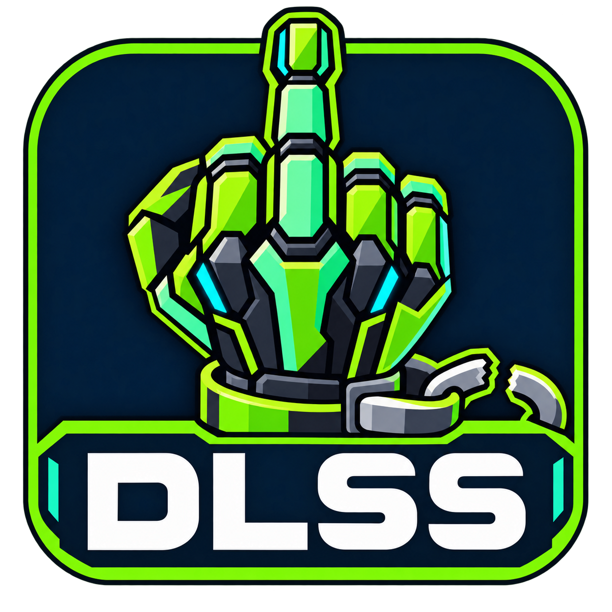

**Language / Sprache:** [Deutsch](README.md) · **English**

<sub>Additional languages — not yet available: Español · Français · Português (Brasil) · Italiano · Polski · Русский · 简体中文 · 日本語</sub>

<p align="center">
  
</p>

# DLSS Manager

**Manage DLSS DLLs, discover games, and install the SM86 FrameGen mod from a Windows interface.**

DLSS Manager is a community tool built with AutoHotkey v2. It detects local DLSS files, displays their versions, and lets you replace them with other available versions. It also manages the FrameGen mod from [dlssg_for_sm86](https://github.com/sdli1995/dlssg_for_sm86), including updates and per-game rollback options.

The logo pokes fun at artificial hardware restrictions. This is an independent project with no affiliation with NVIDIA.

**The application interface is currently in German.** This guide keeps the original German control labels alongside English descriptions so you can find the corresponding buttons and settings. Translating this README does not change the application's language.

> [!WARNING]
> **Use only with single-player games.** DLL replacements and proxy mods can trigger anti-cheat systems and lead to bans. A detected DLSS file does not mean a game is safe to modify. Exclude multiplayer and anti-cheat games; game detection does not guarantee a complete anti-cheat check.

## Features

### Game library and scanning

- Scan game directories for DLSS Super Resolution, Frame Generation, and Ray Reconstruction.
- Record exact DLL paths and installed file versions.
- Add games manually and customize their names, executable paths, and icons.
- Manage scan folders or scan selected local drives.
- Review uncertain executable matches after a scan.
- Block executable filenames globally and exclude game directories with their subdirectories.
- Search and filter games; access additional actions through the right-click menu.

### DLSS DLLs

| Type | File |
| --- | --- |
| Super Resolution / SR | `nvngx_dlss.dll` |
| Frame Generation / FG | `nvngx_dlssg.dll` |
| Ray Reconstruction / RR | `nvngx_dlssd.dll` |

- Load available versions from the public DLSS Swapper manifest.
- Download DLL versions on demand and keep them in a local repository.
- Switch individual DLL types to a selected version.
- Update every existing DLL type in one game to its latest manifest version in a single operation.
- Update DLLs across eligible games that are not running.
- Back up original DLLs as `.bak` files before their first replacement and restore them when needed.

The three DLL types are managed independently. Their latest version numbers do not have to match. Manifest entries not marked as having a valid signature, as well as development builds, are excluded. Available manifest checksums are used to check downloaded files.

### FrameGen mod

- Install and update the SM86 mod from the GitHub release cache.
- Allow installation only when a native `nvngx_dlssg.dll` has been detected.
- Automatically update already installed mods to a newer release.
- Back up existing mod versions for per-game rollback.
- Pause automatic mod updates for a game after a rollback.
- Edit the mod INI and manage per-game settings.
- Apply MFG recommendations to the mod configuration using supported NVIDIA database information.

**Replacing a DLSS DLL and installing the FrameGen mod are separate features.** A game with Super Resolution alone can have its SR DLL updated, but that does not add native FrameGen support.

## Requirements

- 64-bit Windows 10/11, with write access to the manager directory and the game directories you modify.
- To run the source script: **AutoHotkey v2**. AutoHotkey v1 is not compatible.
- For background DLL downloads: Windows PowerShell with `Expand-Archive`, plus the included `dll_repo/PreloadLatestDlls.ps1` file.
- For extracting individual DLL downloads: `tar.exe` available on the system path, normally included with current Windows installations.
- Internet access for manifest, database, mod, and DLL downloads.
- For the FrameGen mod: a GPU, driver, and game combination supported by the upstream mod project.

The newest DLL is not necessarily the best version for every game. Compatibility and behavior depend on the game and mod being used.

## Running the manager

### Source script

1. Extract the project files into a writable directory.
2. Install AutoHotkey v2.
3. Run `DLSSG Manager.ahk`.

Alternatively, run this from PowerShell in the project directory:

```powershell
& "C:\Program Files\AutoHotkey\v2\AutoHotkey64.exe" ".\DLSSG Manager.ahk"
```

Keep the `src` and `dll_repo` folders and their included files alongside the script. Cache, backup, and data files are managed relative to the script directory.

### Compiled version

Run `DLSSG Manager.exe` and keep its resource folders in the same directory. A compiled version does not require a separate AutoHotkey installation to run. PowerShell and the background downloader file are still required.

## Initial setup

1. Open **Einstellungen → Spiele suchen → Scan-Ordner verwalten** — Settings → Find games → Manage scan folders.
2. Add your game library directories, such as your Steam, Epic, or Ubisoft library folders. Adding a scan folder starts a scan.
3. Review discovered games and uncertain executable matches after scanning. Exclude unsuitable games or directories.
4. Under **Einstellungen → Updates & Daten** — Settings → Updates & data — sync the NVIDIA database and update the FrameGen mod cache as needed.
5. Select a game in the list and use the actions in its details panel.

At startup, the manager checks the DLL manifest in the background and prepares the latest available SR, FG, and RR versions in the local repository. **Downloading files into the cache does not replace any game DLLs.**

## Usage

Double-clicking a game launches its saved executable. The right-click menu provides the main game actions regardless of the currently selected details tab.

### DLL versions — DLL-Versionen

- Choose a version from a dropdown, then use **SR tauschen**, **FG tauschen**, or **RR tauschen** to replace that individual DLL type.
- **Alle DLLs aktualisieren** — Update all DLLs — updates the existing DLL types in the selected game to their latest manifest versions. The individual dropdown selections do not determine the target versions for this bulk operation.
- **Original-DLLs wiederherstellen** — Restore original DLLs — restores the available `.bak` files.

The **Alle DLLs aktualisieren** button at the top of the main window performs a bulk update across all eligible games. Running, ignored, and excluded games are skipped.

### FrameGen mod — FrameGen-Mod

This tab provides proxy selection, mod installation, settings, removal, and rollback.

Installation requires a native `nvngx_dlssg.dll` in the game. If only `nvngx_dlss.dll` is present, mod installation remains disabled.

When a rollback backup is available, you can select and restore a previous mod version. Automatic **mod updates** are then paused for that game. A manual mod installation or update clears this pause. The pause does not prevent separate DLSS DLL updates.

### Game and files — Spiel & Dateien

Open the game and log directories, locate the executable in Explorer, change the name, path, or icon, or ignore the game during automatic scans. **Aus Liste entfernen** — Remove from list — removes the management entry without uninstalling game files.

## Status and filters

| Displayed status | Meaning |
| --- | --- |
| Nicht installiert | Not installed: a native FG DLL was detected, but no active SM86 mod was found. |
| Nicht verfügbar | Unavailable: no native FG DLL was detected, so the FrameGen mod cannot be installed. Existing SR/RR DLLs can still be managed. |
| Aktiv (SM86) | Active: the mod directory and selected proxy DLL are present. This status does not verify that the mod works in the running game. |
| Update verfügbar | Update available: the detected mod version differs from the local release cache. |
| Fallback-Version, Updates pausiert | A previous mod version is active, and automatic mod updates are paused for that game. |
| Pfad, DLL oder Ordner fehlt | A path, DLL, or directory is missing. The entry or mod installation is incomplete and should be checked. |

Existing mod and error states remain visible even if a native FG file later goes missing.

Filters include all DLSS games, games with FG, SR games without FG, modified games, active mods, available updates, and problems. **Bereits gemoddet / angepasst** — Already modded / modified — also includes games with original DLL backups.

## Settings and automation

| Setting / process | Behavior |
| --- | --- |
| Mit Windows starten | Start with Windows: creates a startup shortcut for the current user when enabled. The manager starts minimized to the system tray. |
| Manager immer im Vordergrund halten | Always on top: a saved, optional setting for the main and settings windows. Disabled by default. |
| Automatic game scanning | When enabled, scans configured folders at startup and every five minutes. |
| Automatic DLL updates | Optionally checks eligible, closed games every minute against the available manifest and updates them when needed. |
| Mod update check | Checks the GitHub release at startup and every 30 minutes. Already installed mods that are not paused may be updated. |

Bulk updates identify already current DLL files by checksum and do not replace them again. The one-minute check does not fetch an online manifest separately for every game. New version lists are loaded at startup or through a manual manifest refresh.

Minimizing sends the manager to the system tray. Use the tray menu to reopen the window or quit the application. Closing the main window exits the manager.

## Backups and restoration

### Original DLSS DLLs

Before the first replacement, a backup is created beside the game DLL, for example:

```text
nvngx_dlss.dll
nvngx_dlss.dll.bak
```

Subsequent updates do not overwrite this original backup. After a successful restore using **Original-DLLs wiederherstellen**, the restored `.bak` files are removed.

### Mod rollback backups

Mod backups are organized under `ModBackups`. Each contains the backed-up mod directory, its INI, and the associated proxy DLL. History is limited to up to five backups per game.

Mod rollback backups and original DLL backups serve different purposes. **Mod entfernen** — Remove mod — does not restore replaced SR/FG/RR DLLs to their original versions. Use the separate original DLL restoration action for those files.

## Files and directories

| Path | Contents |
| --- | --- |
| `DLSSG Manager.ahk` | AutoHotkey v2 source script. |
| `src/logo.png` | GUI logo with DLSS lettering. |
| `src/app-icon.png` | Simplified icon source without lettering. |
| `src/logo.ico`, `src/favicon.ico` | Icons in multiple resolutions. |
| `games.json` | Game list, DLL paths, metadata, and per-game settings. |
| `manager_config.ini` | General settings, scan folders, and scan rules. |
| `ModCache/` | Downloaded FrameGen mod and database cache. |
| `ModBackups/` | Per-game mod backups. |
| `dll_repo/PreloadLatestDlls.ps1` | Included background downloader. |
| `dll_repo/manifest.json` | Locally saved DLL manifest. |
| `dll_repo/dlss/`, `dll_repo/dlssg/`, `dll_repo/dlssd/` | Locally stored DLL versions. |
| `dll_repo/preload.log` | DLL preparation log. |
| `dll_repo/dll_update.log` | Bulk DLL update error log. |
| `scan_debug.log` | Game scan diagnostic log. |

Game paths and local settings belong to your installation. Before uploading to GitHub, review and exclude personal `games.json`, INI, log, and backup files. Check the redistribution terms of downloaded DLLs and mod caches before publishing them.

## Troubleshooting

**A game is not detected**

Add its actual installation directory as a scan folder and scan again. Check uncertain matches, excluded folders, and the executable blocklist. This DLL-based scan does not automatically discover games without any of the three supported DLL files. Add the game manually if needed and inspect `scan_debug.log`.

**The status says “Nicht verfügbar” even though the game supports DLSS**

Super Resolution and Frame Generation use different files. The SM86 mod requires the native `nvngx_dlssg.dll`. An SR DLL alone is not sufficient.

**Downloads or version lists are missing**

Refresh the version list under **Einstellungen → Updates & Daten**. Check that `dll_repo/PreloadLatestDlls.ps1` is included, PowerShell is available, and the manager directory is writable. See `dll_repo/preload.log` for more details.

**A game stops working correctly after a change**

Close the game. After a DLL replacement, restore the original DLLs or choose another available version. After a mod update, use an available mod rollback backup. Restore the mod and original DLLs separately as needed.

**Useful information for bug reports**

Include the game name, GPU, driver version, affected DLL/mod version, the action you performed, and relevant log excerpts. Remove personal paths before publishing them.

## Building an executable

In **Ahk2Exe**, select `DLSSG Manager.ahk`, use an AutoHotkey v2 64-bit base, and set `src/logo.ico` as the icon. Resource folders are still required alongside the resulting executable.

The included `Compiler.ahk` contains local absolute paths. Adjust them to your environment before use. Source changes and changes to the embedded executable icon take effect in the EXE only after rebuilding it.

## Data sources and credits

- [AutoHotkey](https://www.autohotkey.com/) — scripting language and Windows interface.
- [sdli1995/dlssg_for_sm86](https://github.com/sdli1995/dlssg_for_sm86) — the managed FrameGen mod.
- [beeradmoore/dlss-swapper](https://github.com/beeradmoore/dlss-swapper) and [DLSS Swapper Manifest Builder](https://github.com/beeradmoore/dlss-swapper-manifest-builder) — DLL version information and download references. The manager does not require a running DLSS Swapper installation.
- [JZ6/DLSSdb](https://github.com/JZ6/DLSSdb) — the RTX/DLSS database information used by the manager.

The manager is not an official NVIDIA application. Third-party DLLs, mods, and data sources remain subject to the terms of their respective rights holders and projects.
